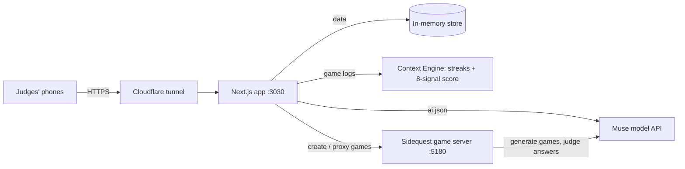

# Hangouts (Meta Closer Together AI Hackathon)

**Group chats that turn into real plans.** Muse drops a game into your group chat, and once you've played it together, Muse suggests something to do together in person.

Group chats die quietly. Someone sends a meme, two people react, and the "we should hang out" never becomes a plan. Hangouts gives the chat a reason to come back every day and a bridge back to real life. Muse, an AI host that lives in the chat, reads what the group shares (where they live, what they post, what they've been talking about) and makes them a quick party game about it. When most of the group has played, it picks a real event that fits them and sends each person a personal note to go together.

Built on a high-fidelity Facebook + Messenger clone, with Meta's Muse models doing every piece of writing, picking and game generation.

**Team:** Nivan, Armaan, Vedansh, Keira, Abishek

## What Hangouts does

1. **Open the group chat.** The first time anyone opens it, Muse reads the group: everyone's location, bio and interests, their recent posts, and the last few messages in the chat.
2. **Muse picks a game for this group.** It chooses one topic everyone shares (here, the Bay Area, because all five live in SF, Oakland or Berkeley) and a few angles from their lives (Bay Area tech, trails, food spots).
3. **The game appears in the chat.** A Deep Cuts round: name things in a category, and rarer answers score more. Muse writes a notification teasing one of its real questions, which slides down on every phone.
4. **Everyone plays on their own time.** Scores post back into the thread as a live leaderboard. (Separately, **Your Hangout** keeps a critter for each friend, awake as long as your daily game streak in your 1:1 chat is.)
5. **Ask for more.** Text "muse, another one" in the chat and Muse replies, then makes a different kind of game that fits the request: a restaurant rush, a race, or a drawing game.
6. **Muse suggests a plan.** Once two people have finished, Muse picks a real upcoming event that fits most of the group, posts a short "take this offline" nudge with the event card, and sends each person their own reason to go.
7. **Go together.** Each note opens the event, with a Going button.

## Why it's different

Recommendation feeds suggest events to *you*. Hangouts suggests them to *a group*, at the moment the group is already engaged with each other, and only once the group has earned it: playing together comes first, so the suggestion lands as a natural next step instead of an ad.

Nothing in the flow is a canned template. Every message, notification and plan is written by Muse from that group's own data, and every event or listing it names is checked in code against what the group can actually see. If the model can't be reached, Muse stays quiet and retries; it never fills the gap with generic text.

## How Muse is used

| Job | Model call | Grounded in |
|---|---|---|
| Pick the first game | `demo.muse-pick-game` (structured output) | Members' profiles, posts, recent chat, shared interests from the Context Engine |
| Generate the game | `rarity.world` + `rarity.answers` | The topic and angles Muse picked |
| Judge unlisted answers | `rarity.judge` (fast model, minimal reasoning) | The prompt and its answer key |
| Paint the game's world | `muse-image` | The topic's most iconic landmark (the Golden Gate Bridge, for the Bay Area) |
| Reply when texted | `demo.muse-reply` | The request, the group, the games played so far |
| Announce a game | `demo.muse-game-ready` | The game's real title and questions |
| Suggest the plan | `demo.muse-suggest-plan` | Profiles, chat, game results, events every member can see |

Every call goes through one AI layer (`src/lib/ai`) and shows up in the AI Inspector (`/dev/ai`) with its prompt, output and latency.

## Architecture



- **One public URL.** The Next.js app proxies the game server's pages and API through fallback rewrites, so phones only ever talk to one address.
- **In-memory store.** Seeded at boot, reset instantly between demo runs. The AI reads the exact objects the UI renders.
- **Caching.** Muse's first pick is cached by a fingerprint of the group's data, and games are cached by topic. A repeat run with the same data posts the game in about a second; change the data and Muse decides again.

## The Context Engine

`src/lib/context` turns games played in a chat into a **Connection Score** (0–100) that decides what a chat has earned: groups at 40, events at 60, Marketplace at 75.

| Signal | Weight | What it measures |
|---|---:|---|
| Turnout | 28% | Share of the chat that finishes each game |
| Streak | 16% | Days in a row a majority played, out of 7 |
| Banter | 16% | Players who chat after finishing, replay, or match answers |
| Shared taste | 12% | How settled the chat is on a topic (one loud player can't set it) |
| Momentum | 10% | Turnout in the last 3 days vs the days before |
| Balance | 7% | Whether everyone is in, or two people carry the chat |
| Cohesion | 6% | Share of member pairs who have played the same game |
| Tempo | 5% | How quickly people play once a game is posted |

It also tracks Snapchat-style daily streaks (with one automatic freeze per week), which power each friend's critter in **Your Hangout**.

## Two demo modes

| | SF weekend plans · `/demo/sf` | Austin cookout · `/demo` |
|---|---|---|
| The group | Our team as five friends around SF, plus Muse | Five Austin characters in "Sunday cookout 🔥" |
| Who starts the game | Muse, from the group's data | The presenter, with **Drop** on `/admin` |
| After the game | One plan for the group: a nudge in the chat and a personal note for each person | Three plan kits: a real event plus Marketplace listings, with the cost split |
| Turn it into a plan | Tap the event, then Going | **Make it an event** creates an invite-only event with the kit attached |

## Quick start

Requires Node 22 (`nvm use`) and a Meta Model API key. Without a key everything runs in mock mode.

```bash
npm install
cp .env.example .env.local     # add MODEL_API_KEY
npm run sidequest              # the game server on :5180 (keep it running)
npm run dev                    # the app on :3000, in a second terminal
```

Open `http://localhost:3000/demo/sf`, pick a person, and follow the guide on your profile. Open more windows (or phones) as other people; identity is per tab.

## Running it for judges

```bash
npm run demo:public
```

Builds the app, starts it on `:3030`, opens a free Cloudflare tunnel and prints a QR code. Judges scan it, each picks a different person, and play on their own phones.

- `/admin` resets every chat, post and notification to the starting data between runs, and drops today's game for the cookout demo.
- Restart the game server after pulling changes; it keeps running old game rules until you do.
- Keep the laptop awake and online. The tunnel URL changes every time the launcher restarts.

## Configuration

Credentials go in `.env.local`. Never commit API keys.

| Variable | Required | Purpose |
|---|---:|---|
| `MODEL_API_KEY` | For live AI | Meta Model API key. Without it the app runs in mock mode |
| `MODEL_API_BASE_URL` | No | Defaults to `https://api.meta.ai/v1` |
| `MODEL_TEXT`, `MODEL_IMAGE` | No | Model ids. `/dev/ai` → **List models** shows the ones your key can use |
| `AI_MODE` | No | `auto` (live when a key is set), `live` or `mock` |
| `MODEL_BUDGET_USD` | No | Hard spending cap; every call is booked in `.ai-ledger.json` |

## Privacy and safeguards

| Boundary | Rule |
|---|---|
| What Muse reads | Only this chat's messages and games, members' public profile interests, and events or listings every member can see. Never anyone's private saves or other chats |
| What Muse names | Event and listing ids are checked against the candidate list in code; a plan naming anything else is dropped before anyone sees it |
| Topic choice | A topic needs most of the group behind it, so one loud member can't steer the chat's suggestions |
| Invite-only events | Events made from a chat's plan are visible only to the host and the people invited |
| Model failures | Muse retries with backoff. If it still can't answer, it sends nothing rather than canned text |

## Commands

| Command | Description |
|---|---|
| `npm run dev` | App dev server on `:3000` |
| `npm run sidequest` | Game server on `:5180` (Deep Cuts, Order Up!, Ghost Run, Sketch Off) |
| `npm run demo:public` | Production build + public tunnel + QR code, for judges' phones |
| `npm run build` / `npm start` | Production build and serve |
| `npm test` | Context Engine, event picks, streaks and judge demo tests |
| `npm run typecheck` | `tsc --noEmit` |
| `npm run reset` | Restore the seed data (server must be running) |
| `npm run warm` | Cache every seed image locally for offline demos |

## Project layout

| Path | What |
|---|---|
| `src/server/demo.ts` | Muse in the SF demo: picks the game, replies when texted, suggests the plan |
| `src/lib/demo/` | The cookout demo: game drop + nudges (`drop.ts`), plan kits (`museIdeas.ts`) |
| `src/lib/context/` | Context Engine: sessions from game logs, streaks, Connection Score, topic taxonomy, visibility |
| `src/lib/streaks/`, `src/components/hangout/` | Your Hangout: one critter per friend, kept awake by playing together |
| `src/lib/ai/` | The AI layer: text, structured output, images and tools over Muse, with tracing and mock mode |
| `sidequest/` | The game server and the four games' clients |
| `src/data/` | Seed data, including the SF cast (`demo.ts`) |
| `src/app/` | Every Facebook and Messenger surface, plus `/demo`, `/admin` and the inspectors in `/dev` |
| `scripts/` | `demo-public.ts` (judge launcher), image generators for demo photos |

The base app also includes Feed, Reels, Profiles, Groups, Events, Marketplace, Dating and Search, all seeded with a lived-in Austin friend group, so features can connect across the whole app.

## Built with

Meta Muse models (`muse-spark`, `muse-ember`, `muse-image`), Next.js 15, React 19, TypeScript, Tailwind CSS, esbuild and Cloudflare Tunnel.
